<div align="center">

# Net Worth

**Family finances, together.** Import your bank extracts, see where the money went, catch spending spikes
before they hurt and look years ahead, on Android, iOS and the web, from one Kotlin Multiplatform codebase.

[](https://github.com/neteinstein/Net-Worth/actions/workflows/pr.yml)
[](https://github.com/neteinstein/Net-Worth/releases)
[](https://neteinstein.github.io/Net-Worth/)


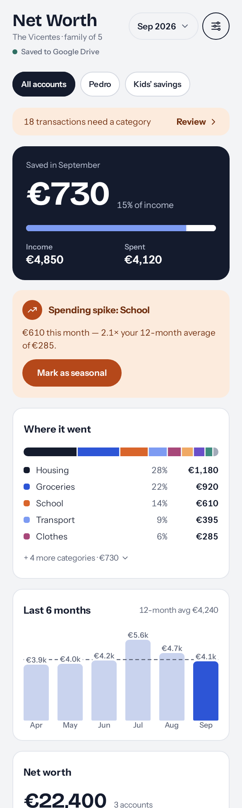
&nbsp;&nbsp;
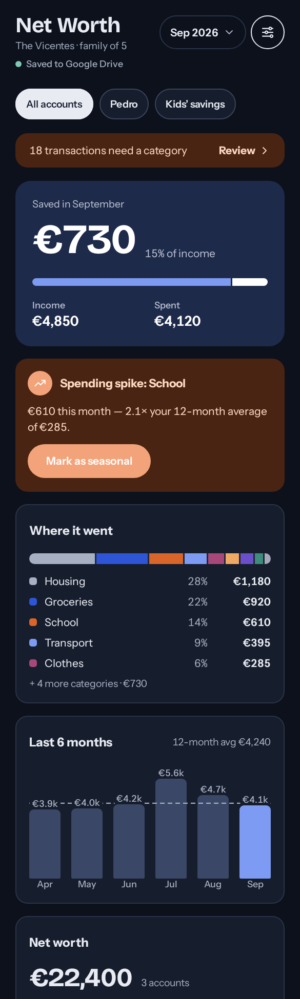

</div>

---

## Why Net Worth

- 🔒 **Your data stays yours.** No backend, no account with us. All of the family's data is **one JSON file
  in your own Google Drive**, shared between the parents. Drive keeps the revisions, so you get backups and
  undo for free.
- 👨‍👩‍👧‍👦 **Built for a household, not a person.** Accounts have owners, movements can be tagged for a
  person, and you can look at *all accounts*, one parent, or the kids' savings.
- 🏦 **Bring the statements you already have.** CSV, OFX/QFX, XLSX and PDF, including novobanco and
  Banco Best "Extrato Integrado" statements, parsed entirely on-device in pure Kotlin.
- 🧠 **It learns.** Every category you pick in *Review & learn* becomes a merchant rule, so next month's
  import files itself.
- 🚨 **It speaks up.** Spending spikes against your 12-month average, new recurring payments, 3-month rises,
  large payments, budgets you are about to blow, and what went well.
- 🔮 **It looks ahead.** Savings projections over 2–10 years, what-ifs, an emergency fund check, a 12-month
  forecast with expected peaks and a 5-year table built from your own assumptions.

## A tour

| | | |
| :---: | :---: | :---: |
| 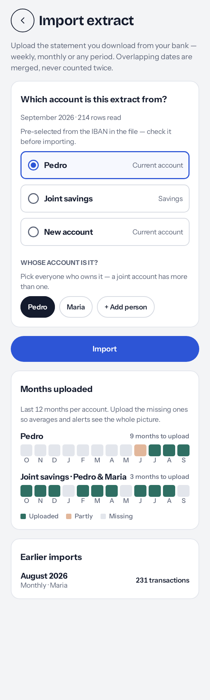 | 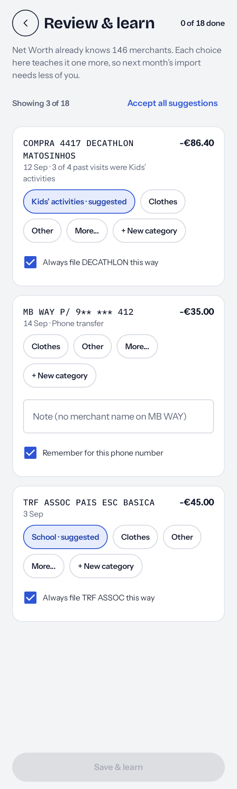 | 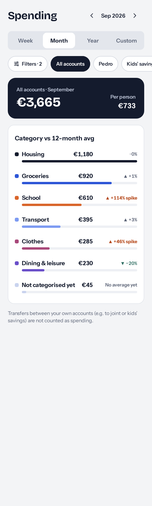 |
| **Import** an extract, match it to accounts and owners | **Review & learn**: categorise once, rules do the rest | **Spending** by category, against budgets |
| 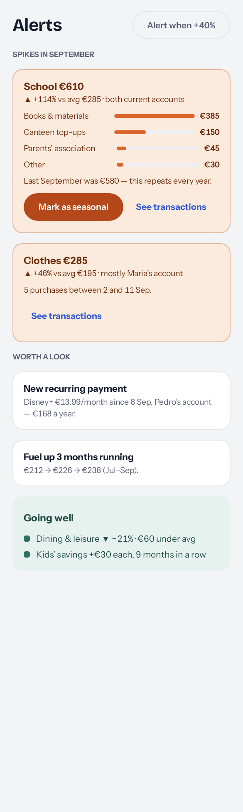 | 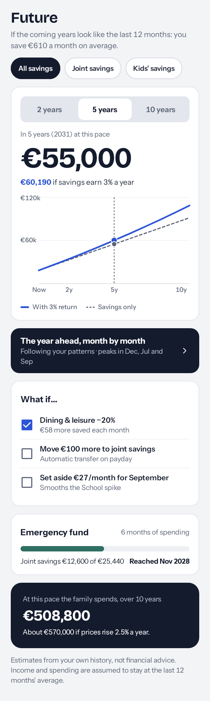 | 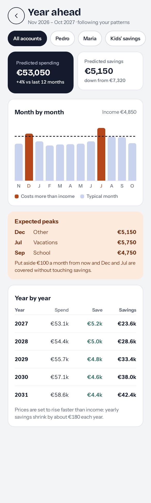 |
| **Alerts & insights** that explain themselves | **Future**: projections, what-ifs, emergency fund | **Year ahead**: 12-month forecast and 5-year table |
| 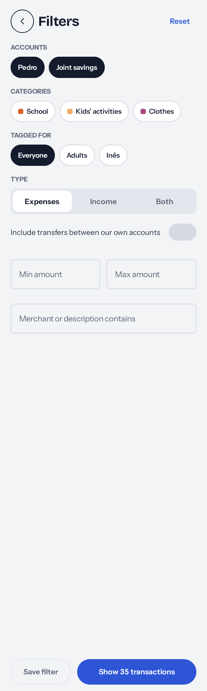 | 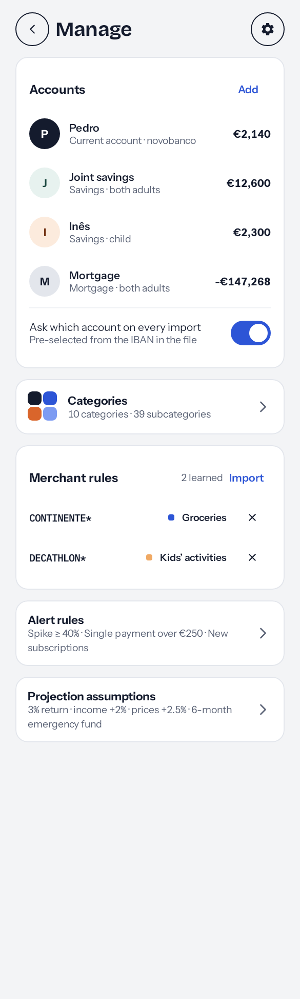 | 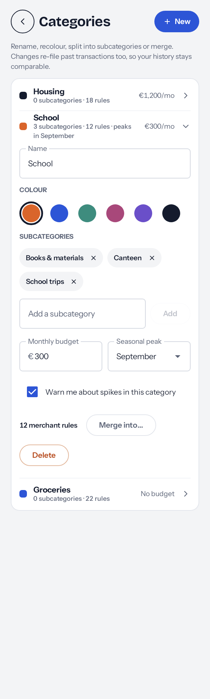 |
| **Filters** and a transaction list to re-file and tag | **Manage** accounts, rules, alerts and assumptions | **Categories** and their monthly budgets |

<sub>Screens are the app's own screenshot-test goldens, rendered on the JVM with example data (every screen
also has a dark-mode golden next to it).</sub>

## How it works

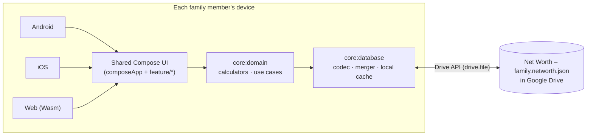

1. **Sign in with Google**, then **Start fresh** (creates the family file in your Drive) or **Open a Google
   Drive file** that your partner shared with you.
2. Changes are written to a local cache immediately and uploaded to Drive shortly after.
3. Every record carries an `id` and `updatedAt`, so two people editing at the same time are **merged record
   by record**, deletions included.

The app only ever asks for the non-sensitive `drive.file` scope: it can see the files it created or that
you picked, nothing else in your Drive. Details: [docs/database.md](docs/database.md).

## Get it

| Platform | How |
| --- | --- |
| 🤖 Android | Release pipeline disabled for now (see [CI_CD.md](CI_CD.md)); earlier builds → [Releases](https://github.com/neteinstein/Net-Worth/releases) |
| 🌐 Web | Deployed to [GitHub Pages](https://neteinstein.github.io/Net-Worth/) and Cloudflare Pages on every push to `main` |
| 🍎 iOS | Build from source with Xcode (below) |

## Build from source

You need JDK 21 and the Android SDK; iOS needs macOS with Xcode.

```bash
cp androidApp/google-services.json.ci androidApp/google-services.json   # once; the real file is git-ignored

./gradlew :androidApp:installGithubDebug              # Android
./gradlew :composeApp:wasmJsBrowserDevelopmentRun     # Web dev server
open iosApp/iosApp.xcodeproj                          # iOS (its Run Script builds the Kotlin framework)
```

Google sign-in needs OAuth client ids from your own Google Cloud project, read from `local.properties` or
the environment: see [docs/google-cloud-setup.md](docs/google-cloud-setup.md). Without them the app still
builds, and sign-in reports "not configured".

### Checks

```bash
./gradlew testDebugUnitTest                 # all shared unit tests + screenshot tests (JVM)
./gradlew ktlintCheck                       # style (ktlintFormat to fix)
./gradlew :androidApp:lintGithubDebug       # Android lint across every module
./gradlew :koverLog :koverVerify            # coverage, 80 % gate
./gradlew testDebugUnitTest -PrecordScreenshots   # re-record goldens after an intended UI change
```

## Under the hood

| | |
| --- | --- |
| **Language / UI** | Kotlin 2.4, Compose Multiplatform 1.12, Material 3 |
| **Architecture** | Clean architecture (domain / data / ui) + MVVM, Coroutines + `StateFlow` |
| **DI · Navigation** | Koin 4.2 · Navigation 3 with type-safe `@Serializable` routes |
| **Data** | Google Drive JSON file + local cache, Ktor 3, kotlinx-serialization, kotlinx-datetime |
| **Sign-in** | Credential Manager (Android) · OAuth PKCE (iOS) · Google Identity Services + Picker (Web) |
| **Targets** | Android minSdk 32 / targetSdk 37 · iOS 17+ (arm64) · `wasmJs` browser |
| **Quality** | `kotlin.test`, Roborazzi screenshot tests, ktlint, Android lint, Kover ≥ 80 %, R8 obfuscation check |

```
androidApp/      thin Android app (manifest, Activity, R8 rules)
composeApp/      app shell: App(), navigation, Koin, iOS + web entry points
core/            domain · database · google · designsystem · testing
feature/         onboarding · overview · importer · spending · alerts · future · manage · settings
iosApp/          SwiftUI host for ComposeApp.framework
build-logic/     Gradle convention plugins
```

## Documentation

| Doc | What's in it |
| --- | --- |
| [AGENTS.md](AGENTS.md) | Architecture, module layout, conventions and gotchas: **start here to contribute** |
| [CI_CD.md](CI_CD.md) | PR checks, releases, signing, GitHub Pages |
| [docs/database.md](docs/database.md) | The shared family file, its format and how it syncs |
| [docs/importing.md](docs/importing.md) | Statement formats, bank profiles and what an import does |
| [docs/google-cloud-setup.md](docs/google-cloud-setup.md) | The OAuth clients Google sign-in needs |
| [docs/design/](docs/design/README.md) | The design canvas the app is built from |

## Contributing

PRs welcome. Use [Conventional Commits](https://www.conventionalcommits.org/) for commits and the PR title
(`feat(overview): …`), fill in the PR template, and ship new logic with tests. New screens get screenshot
tests. **Never commit real bank statements**: build synthetic fixtures with invented values instead.
